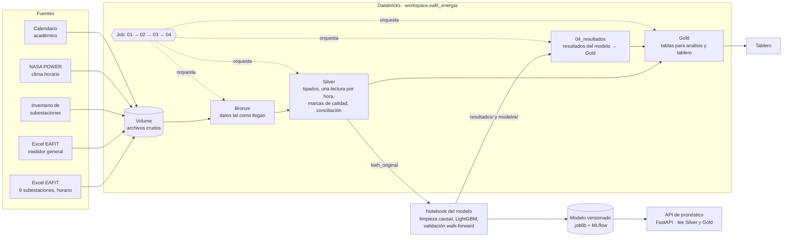

# Pronóstico del consumo energético del campus EAFIT

**Proyecto Integrador 1 · Maestría en Ciencia de Datos y Analítica · Universidad EAFIT**

Pronóstico horario de la energía que el campus de Medellín compra a la red (EPM) en sus 9 subestaciones con medición, para
anticipar los periodos de alto consumo, tener una línea base contra la cual detectar desviaciones y expresar el consumo
esperado en kWh y en pesos.

| Curso | Componente | Carpeta |
|---|---|---|
| SI7006 · Almacenamiento y Procesamiento de Grandes Datos | Arquitectura *lakehouse* Medallion en Databricks (Bronze → Silver → Gold), resultados del modelo en tablas Gold, API | [`databricks/`](databricks/), [`api/`](api/) |
| SI7009 · Aprendizaje Automático | Modelo de pronóstico (LightGBM), validación temporal sin fuga, métrica de negocio | [`modelo/`](modelo/) |
| SI7007 · Visualización de Datos | Tablero interactivo sobre las tablas Gold | [`tablero/`](tablero/) |

**Equipo:** Zarith Isabella Restrepo Giraldo · Juan José Restrepo Hernández · Luis Felipe Quesada · Isabela Osorio Botero ·
Marcela Londoño León.

> 🌐 **Este es el repositorio público.** Los datos de consumo son de la Universidad EAFIT y no son abiertos. Aquí está todo el
> código, la arquitectura y el análisis completo **con datos transformados**: subestaciones con código anónimo (SUB1 a SUB9) y
> toda cifra de energía (kWh) y de costo (COP) multiplicada por un factor confidencial. Las curvas, las proporciones y todas
> las métricas relativas (WAPE, % de mejora, sensibilidad de alertas) son **idénticas** a las de la versión con los valores
> reales, que se presenta en la sustentación. Ver [Datos y confidencialidad](#datos-y-confidencialidad).

## Resultado principal

El modelo elegido, **LightGBM ajustado**, pronostica a las 00:00 las 24 horas del día siguiente en las 9 subestaciones con un
**WAPE de 9,32 %** en el periodo de prueba (1-ago a 22-oct-2026, 83 días que el modelo nunca vio), frente a **17,16 %** de la
regla "misma hora de la semana pasada" (**−46 %**). Le gana a esa regla en las 9 subestaciones.

- Hallazgos principales, con gráficos: [`docs/hallazgos/`](docs/hallazgos/)
- Análisis completo paso a paso (notebook ejecutado, con todas sus salidas): [`modelo/`](modelo/)

## Arquitectura



Decisiones clave:

- **Lakehouse por zonas (Medallion):** los datos llegan en lotes (archivos que entrega la universidad y descargas de clima), el
  volumen es moderado y el pronóstico se emite una vez al día, así que no hace falta *streaming*: procesamiento por lotes con
  Spark sobre tablas Delta, catalogadas en Unity Catalog.
- **El modelo lee de Silver el valor original de cada hora**, no la columna limpia: la limpieza de Silver describe toda la
  historia (puede mirar el futuro) y el modelo necesita una limpieza *causal* para no tener fuga de información. El notebook
  del modelo compara las dos limpiezas.
- **Los resultados del modelo vuelven a Databricks** como tablas Gold, que son las que consume el tablero.

Más detalle en [`docs/arquitectura.md`](docs/arquitectura.md).

## Estado

| Parte | Estado | Dónde |
|---|---|---|
| Notebooks Bronze, Silver y Gold | ✅ Corriendo en Databricks · ⏳ falta subirlos al repositorio | [`databricks/`](databricks/) |
| Modelo de pronóstico (v4, lee de Databricks) | ✅ Listo | [`modelo/`](modelo/) |
| Hallazgos con gráficos | ✅ Listo | [`docs/hallazgos/`](docs/hallazgos/) |
| Resultados del modelo → tablas Gold (`04_resultados`) | ✅ Listo | [`databricks/04_resultados.py`](databricks/04_resultados.py) |
| Job que encadena los notebooks | ⏳ Pendiente de subir | [`databricks/jobs/`](databricks/jobs/) |
| API del modelo | ✅ Lista: FastAPI que calcula el pronóstico de cualquier día y consulta el emitido en Gold; lee de Databricks (Silver y Gold) con respaldo local; 25 pruebas | [`api/`](api/) |
| Tablero | ⏳ Pendiente de subir | [`tablero/`](tablero/) |
| Presentación | ⏳ Pendiente | [`docs/presentacion/`](docs/presentacion/) |

## Estructura del repositorio

```
├── databricks/        Pipeline Medallion (01_bronze, 02_silver, 03_gold), 04_resultados y el Job
├── modelo/            Notebook del modelo (versión pública, ejecutado), resultados agregados y ficha del modelo
├── api/               API que sirve el modelo
├── tablero/           Tablero de visualización y sus consultas
├── datos/             Catálogo de fuentes de datos y archivos públicos (los de EAFIT no se suben)
└── docs/              Arquitectura, hallazgos, supuestos confirmados con la universidad y presentación
```

## Datos y confidencialidad

Según el acuerdo del proyecto con la universidad, **no se publican datos horarios por subestación** y los resultados públicos
van **agregados, anonimizados o transformados**. Por eso:

| Qué | En este repositorio |
|---|---|
| Código (pipeline, modelo, `04_resultados`), arquitectura y documentación | ✅ Completo |
| Notebook del modelo ejecutado con gráficos y tablas | ✅ Con datos transformados (SUB1-SUB9, kWh y COP escalados) |
| Métricas (WAPE, MASE, % de mejora, alertas) | ✅ Iguales a las reales |
| Clima de NASA POWER y calendario académico | ✅ Son públicos |
| Excel de la universidad (consumo por subestación, medidor general, inventario) | ❌ No se suben |
| Resultados hora a hora por subestación, modelo entrenado (`.joblib`) y registro MLflow | ❌ No se suben |
| Capacidad de los transformadores y qué bloques atiende cada subestación | ❌ No se publican |

Para ejecutar el proyecto se necesitan los datos de EAFIT y el archivo `datos/privado.json` (alias, capacidades y factor de
escala), que tiene el equipo: ver [`datos/README.md`](datos/README.md).

## Cómo correr el proyecto

1. **Databricks:** subir los archivos de [`datos/`](datos/README.md) al Volume y correr los notebooks de [`databricks/`](databricks/)
   en orden (01 → 02 → 03), o el Job.
2. **Modelo:** ver [`modelo/README.md`](modelo/README.md). Para alimentar Databricks y el tablero con los valores reales se usa
   la versión completa del notebook, que guarda el equipo; la de este repositorio es la versión pública.
3. **Resultados a Gold:** correr [`databricks/04_resultados.py`](databricks/04_resultados.py).
4. **Tablero:** abrir el tablero de [`tablero/`](tablero/), que lee las tablas Gold.

## Cómo se evalúa

Cada criterio se califica Excelente (4,5-5,0), Aceptable (3,0-4,4) o Insuficiente (< 3,0); la nota de cada materia es el
promedio ponderado.

| SI7009 · Aprendizaje Automático | Peso | SI7006 · Almacenamiento y Procesamiento | Peso | SI7007 · Visualización | Peso |
|---|---|---|---|---|---|
| Formulación del problema, EDA e ingeniería de características | 20 % | Arquitectura de referencia y flujo de datos | 10 % | Construcción de la argumentación visual | 20 % |
| Entrenamiento, validación, métricas y diagnóstico | 30 % | Almacenamiento de datos | 20 % | Construcción del mensaje | 20 % |
| Valor de negocio y caso aplicado | 20 % | Procesamiento distribuido | 20 % | Dashboard o informe interactivo | 30 % |
| Sustentación (el modelo funcionando) | 30 % | Despliegue de modelos y consumo | 20 % | Sustentación | 30 % |
| | | Sustentación (el pipeline funcionando) | 30 % | | |

## Cómo agregar archivos al repositorio

- **Desde GitHub (lo más fácil):** entrar a la carpeta que corresponde → *Add file* → *Upload files* → arrastrar los archivos →
  escribir qué se subió → *Commit changes*.
- **Desde Databricks:** *Workspace* → *Create* → *Git folder* con la URL de este repositorio; mover ahí los notebooks y usar
  *Commit & push*.
- Para subir archivos hay que ser colaborador del repositorio (*Settings* → *Collaborators*).
- **Antes de subir un notebook, borrar sus salidas** si muestran datos reales (*Edit* → *Clear all outputs* en Databricks o en
  Jupyter). Nunca subir tokens, archivos `.env`, los Excel de la universidad ni `datos/privado.json`.
