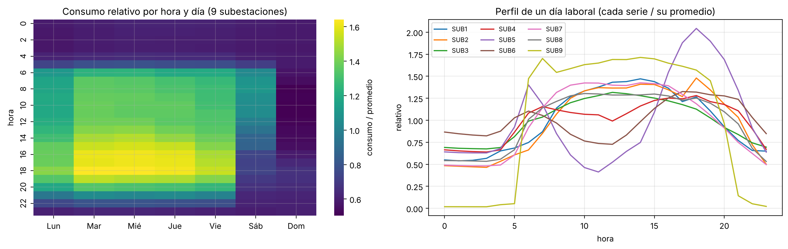
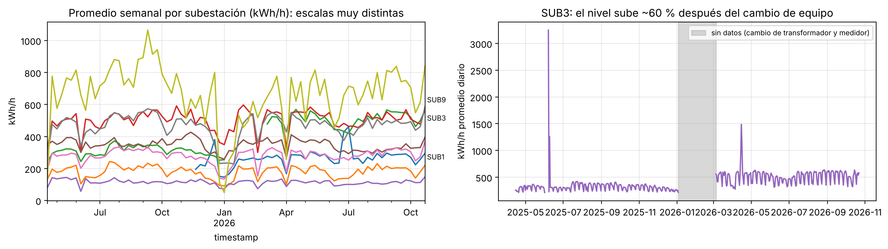
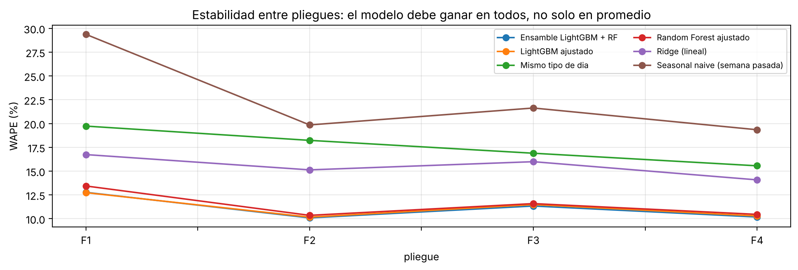
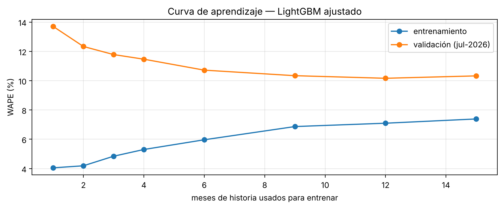
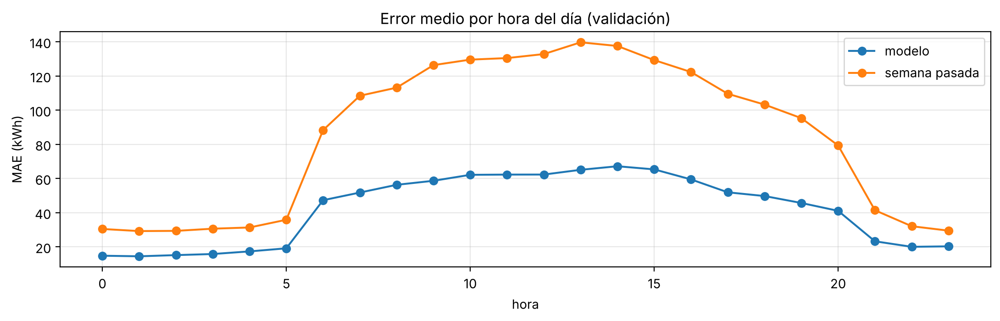
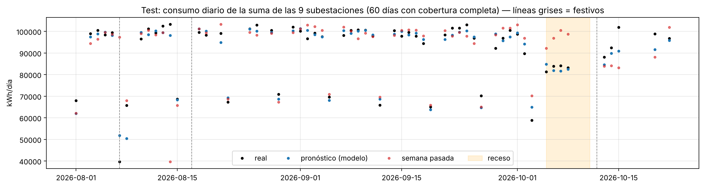
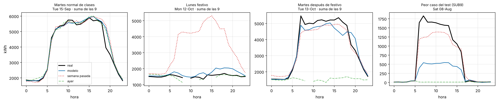
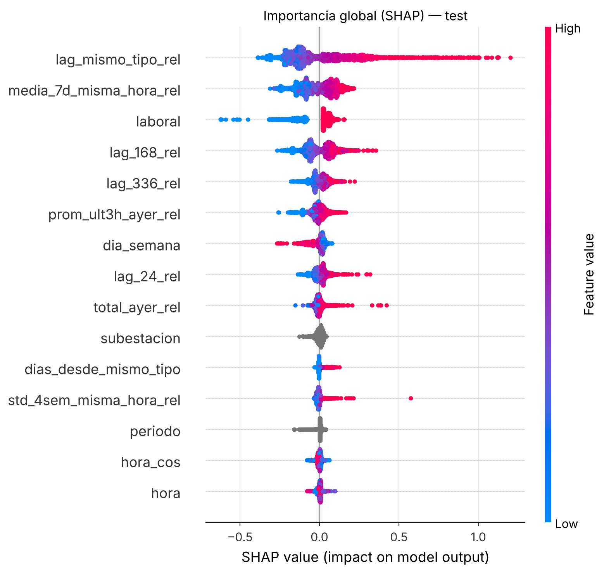

# Hallazgos principales

Resumen visual del modelo de pronóstico. Todo sale del notebook público ([`modelo/`](../../modelo/)): subestaciones con código
anónimo (SUB1 a SUB9) y **kWh escalados por un factor confidencial**. Las formas, las proporciones y todos los porcentajes son
los reales.

## 1. El problema: 9 series con formas y escalas muy distintas

El campus consume con un patrón semanal muy marcado: alto de lunes a viernes entre las 6:00 y las 20:00, bajo los fines de
semana. Pero cada subestación tiene **su propia curva**: SUB9 (climatización) arranca de golpe a las 6:00 y se apaga en la
noche; SUB5 baja al mediodía porque tiene generación solar propia y compra menos a la red cuando hay sol.

Las subestaciones consumen en escalas muy diferentes y SUB3 cambió de nivel (+60 %) tras un cambio de equipo. **Decisión:** un
solo modelo para las 9 series que aprende el consumo **relativo** al nivel de la última semana, en vez de kWh absolutos.

## 2. Selección del modelo: gana en todos los pliegues de validación, no solo en promedio

Validación *walk-forward* (4 meses, abr-jul 2026). Los modelos de árboles (LightGBM, Random Forest y su ensamble) le ganan a
las reglas simples y a la regresión lineal en cada pliegue. La regla de selección, fijada **antes** de ver el test, elige el
modelo más simple cuando dos están a menos de 0,1 puntos: **LightGBM ajustado**.

Con más historia el error de validación baja de ≈ 14 % (1 mes) a ≈ 10 % (9 meses) y luego se estabiliza; la brecha con el
entrenamiento se cierra, así que el modelo no está sobreajustado.

## 3. Resultado en el test (83 días que el modelo nunca vio)

| Método | WAPE horario | MASE |
|---|---|---|
| **LightGBM ajustado (elegido)** | **9,32 %** | 0,48 |
| Ensamble LightGBM + Random Forest | 9,38 % | 0,48 |
| Random Forest ajustado | 9,75 % | 0,50 |
| Ridge (lineal) | 14,06 % | 0,69 |
| Regla "semana pasada" (lo que se haría sin modelo) | 17,16 % | 0,88 |

El modelo **reduce el error ≈ 46 %** frente a la regla "semana pasada" y le gana en las 9 subestaciones. Se evaluó como se
usaría: emitiendo el pronóstico cada día a las 00:00, con solo la información disponible a esa hora, reentrenando cada 7 días.

El error se concentra en las horas de actividad, que son las que más cuestan; ahí la mejora es mayor.

Cada punto es un día de la suma de las nueve subestaciones. Sumando las 24 horas, el error del presupuesto diario de las nueve subestaciones baja de ≈ 6,8 % a ≈ 3,1 % del costo diario.

## 4. Casos concretos: dónde acierta y dónde falla

- **Martes normal de clases:** el modelo sigue la curva real casi exactamente.
- **Lunes festivo:** la regla "semana pasada" espera un día de clases; el modelo sabe que es festivo y acierta.
- **Martes después del festivo:** el modelo no se confunde con el festivo del día anterior.
- **Peor caso (SUB9, sábado de puente):** la climatización se encendió como en un día laboral y nada de lo disponible a
  medianoche lo anticipaba. Es exactamente el tipo de día que debe disparar una **alerta**, y una agenda de eventos ayudaría.

## 5. Qué pesa en el pronóstico

Lo que más pesa es el consumo reciente de la misma subestación, relativo a su nivel: el último día del mismo tipo, la media
de la última semana a la misma hora y la misma hora de la semana pasada. Le siguen si el día es laboral y el día de la
semana. El clima de NASA POWER no mejoró el pronóstico en validación.

## 6. Valor para la universidad

- **Reducción estimada del error de planeación:** ≈ 45 % del error en pesos frente a no tener modelo, equivalente a ≈ 7,7 %
  del costo estimado de la energía del periodo de prueba (tarifa estimada; no es ahorro en la factura).
- **Alertas:** banda elegida en validación y congelada antes del test (q99, ≥ 2 horas): ≈ 1,3 alertas por semana.
- **Límites:** sin agenda de eventos ni generación solar horaria; el reentrenamiento es semanal.

Las cifras en kWh y pesos reales se presentan en la sustentación.
